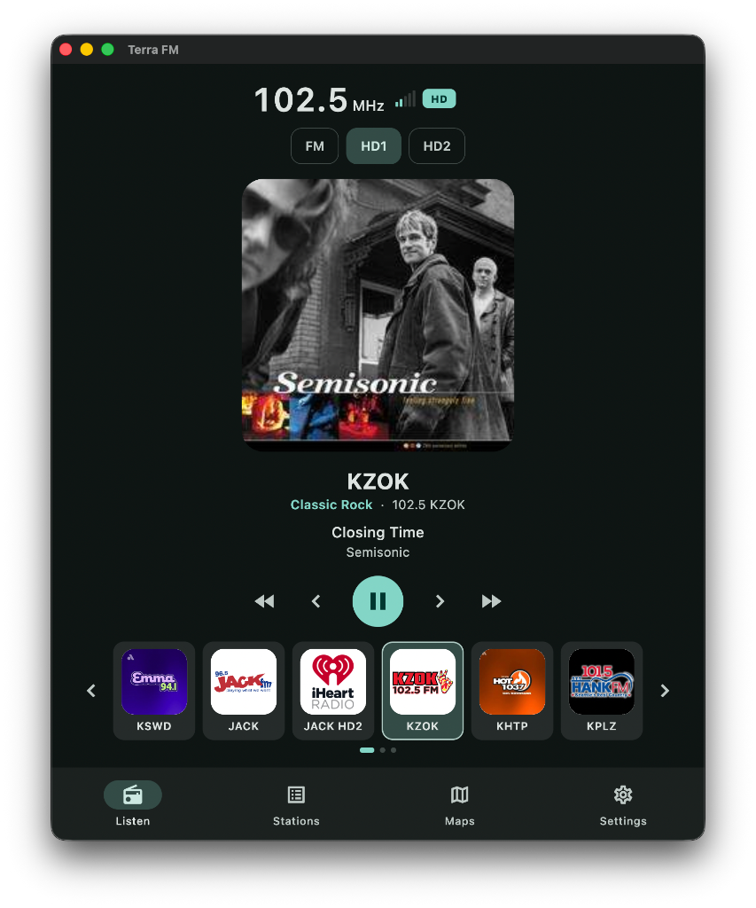
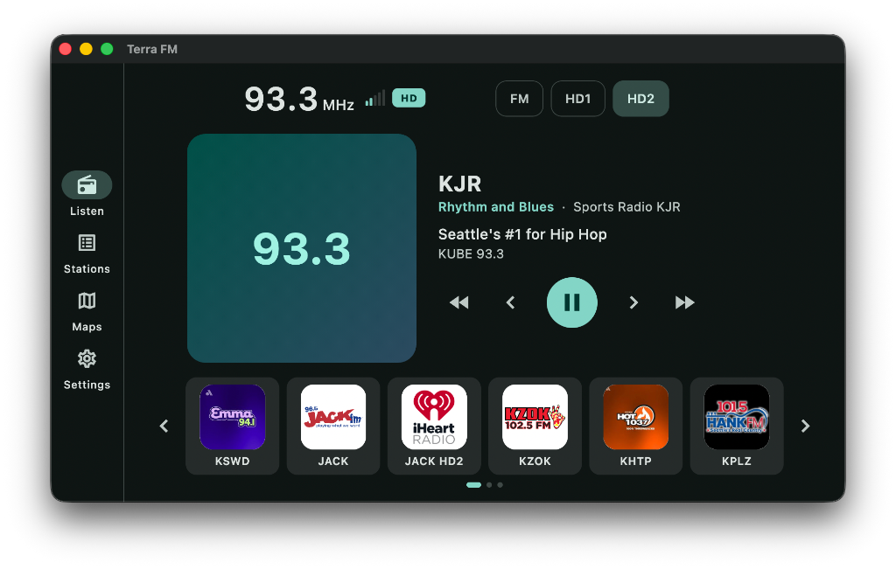
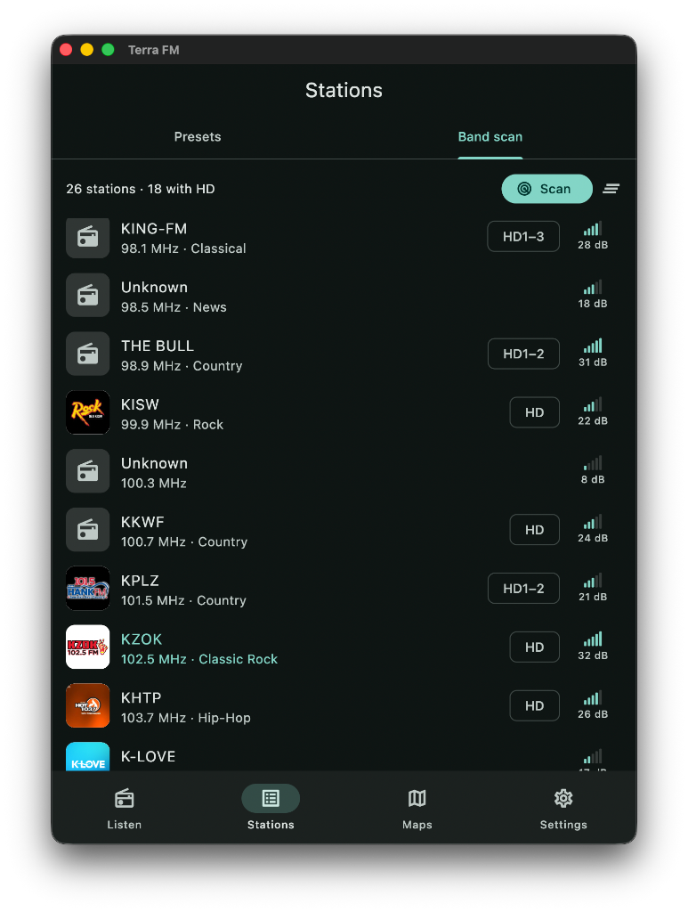
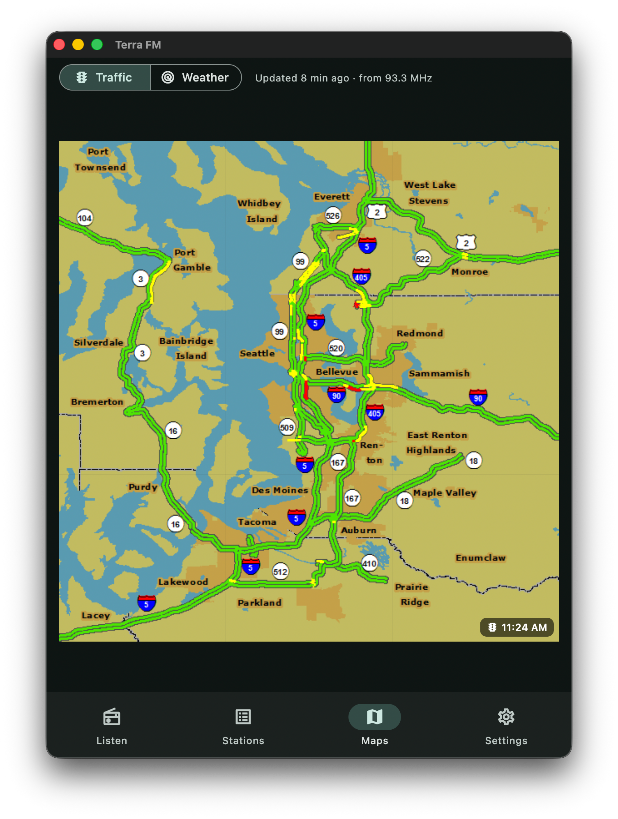
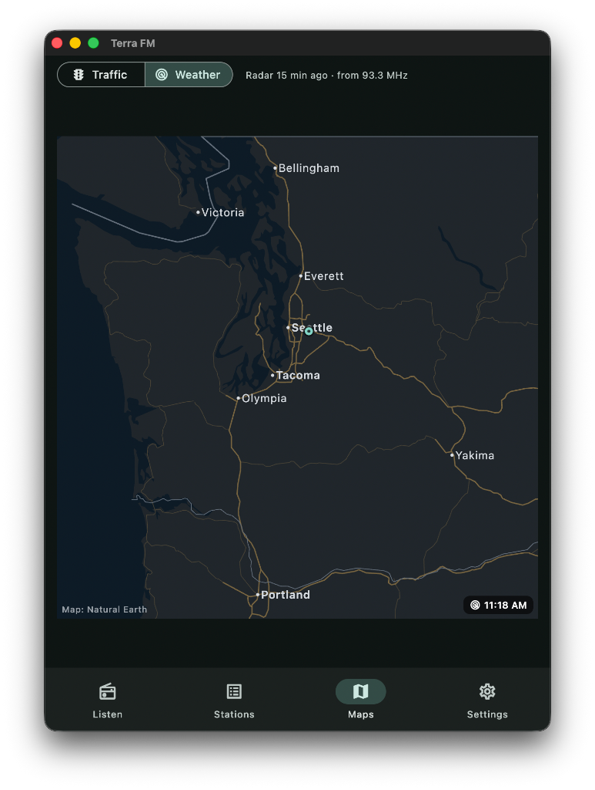
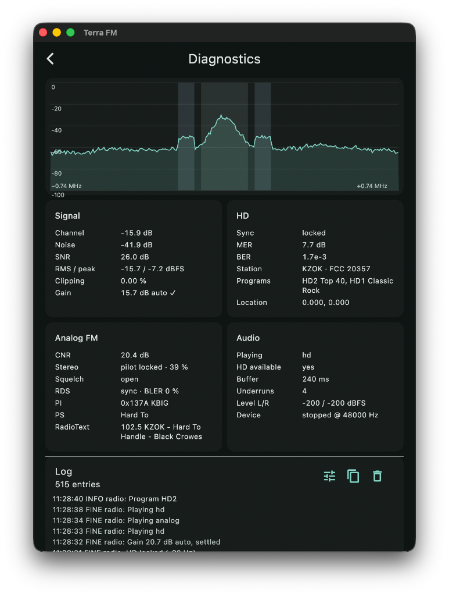

# Terra FM

 

> _Now playing on macOS_

HD (NRSC-5) and analog FM Radio receiver for USB tuners, built with
Flutter. Android, macOS, Windows and Linux.

- HD audio (HD1–HD8), station name/slogan, song titles, album art and
  station logos
- Analog FM with stereo and RDS. In Auto mode HD1 blends to analog when the digital signal drops and back when it recovers
- Smart gain control per-frequency
- Traffic maps and weather radar from stations that broadcast them (HERE
  Images and older TTN data services), with a radar loop over an offline map
- Presets, seek, and a band scan that finds stations and labels HD ones
- Background playback with lock-screen / notification controls
- Layouts for smaller screens and head units

Tested hardware targets: RTL-SDR Blog V3 and Nooelec NESDR v5 (R820T2)
Any tuner known to librtlsdr should work

## Screenshots

### Station Scan



### Maps

 

Traffic and weather come from stations that broadcast them

### Diagnostics



## Building

Requirements: [FVM](https://fvm.app) (the project pins Flutter in `.fvmrc`),
CMake ≥ 3.22, and a C/C++ toolchain. Android builds use the NDK that Flutter
selects.

```bash
fvm install
fvm flutter pub get
fvm flutter run
```

The first build downloads the pinned native dependencies (nrsc5, FAAD2,
librtlsdr, libusb, miniaudio) into `third_party/` and compiles
`libterra_core` through the Dart build hook (`hook/build.dart`)

Platform notes:

- **Android:** plug the tuner in with a USB-OTG adapter. Android should offer to open Terra FM and grant USB access
- **macOS:** the app is sandboxed with USB and network entitlements
- **Linux:** install udev rules for RTL-SDR (`rtl-sdr` package) and blacklist the `dvb_usb_rtl28xxu` kernel module
- **Windows:** nrsc5 needs MinGW-w64 (MSYS2 UCRT64), MSVC can't compile it. Install the WinUSB driver for the tuner with Zadig or similar

## Development

```bash
fvm flutter analyze
fvm dart run tool/ffigen.dart    # regenerate bindings
fvm dart run tool/build_basemap.dart  # rebuild basemap
```

The base map is generated from Natural Earth data (downloaded into
`build/basemap_src/`)

Layout:
- `native/`: the C/C++ engine (`terra_core.h` is its only public API).
- `lib/src/engine`, `lib/src/native`: Dart engine interface and FFI.
- `lib/src/radio`: state, reducer, controller (presets, seek, scan).
- `lib/src/maps`: traffic/weather map assembly, radar images, base map.
- `lib/src/ui`: screens.
- `packages/terra_usb`: Android plugin for USB permission and file
  descriptor hand-off

## To do

- More SDRs (Airspy, HackRF, SDRplay) through the same source interface, with a resampler to 1,488,375 sps
- Automatic alignment of HD and analog audio, instead of a fixed blend
- AM HD, which needs direct sampling or an upconverter on RTL-SDR
- Base map coverage outside North America
- Android Auto-browse for presets and the station list
- Web, via WebUSB and a WebAssembly build of the engine
- iOS over rtl_tcp

## License

GPL-3.0-or-later (required by nrsc5). See `LICENSE` and
`THIRD_PARTY_NOTICES.md`.

AI disclosure: see [AI_DISCLOSURE.md](AI_DISCLOSURE.md).